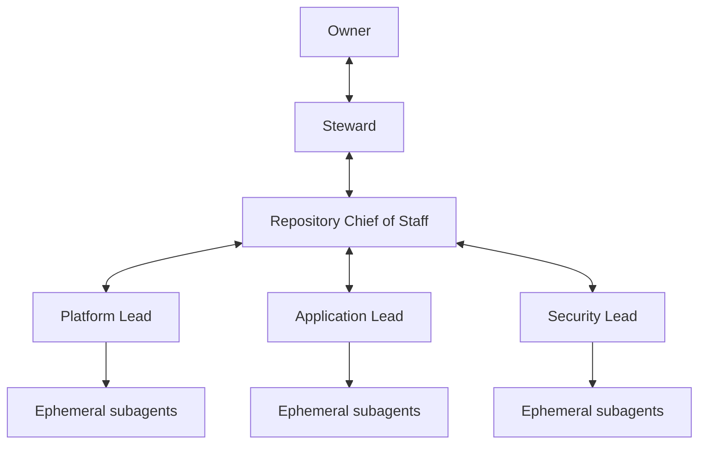

# Kovan

**Organization as code for autonomous engineering teams.**

Define agent roles, ownership, delegation and coordination in your repository. Bring your own agent runtime, tools and automation.

Kovan is a lightweight convention, not another agent harness or orchestration server.



Persistent leadership. Ephemeral execution. Human governance.

## Quick start

Add a small set of Markdown role definitions:

```text
AGENTS.md
.kovan/
  cos.md
  leads/
    platform.md
    application.md
    security.md
```

Use [the specification](SPEC.md) and [the minimal example](examples/minimal/README.md) to bootstrap roles in your existing agent runtime. The runtime must explicitly load the approved role and repository instructions; Kovan does not provide automatic discovery or session management.

## How it works

- **Owner:** sets policy and retains approval authority.
- **Steward:** an optional owner-facing assistant, possibly across repositories.
- **Chief of Staff:** one designated repository supervisor; triages work, coordinates Leads, and drives verified backlog closure.
- **Leads:** own domains, make scoped technical decisions, delegate and verify results.
- **Subagents:** execute one bounded task and return evidence to their Lead.

Keep cross-Lead communication vertical through the CoS. Encourage agents to report evidence-backed bugs and improvement opportunities, deduplicate issues, and avoid expanding assigned work silently.

## Bring your own stack

| Responsibility | Example |
| --- | --- |
| Organization | Kovan role files |
| Agent execution | OpenCode |
| Work state | GitHub issues and PRs |
| Events and reconciliation | GitHub Actions |
| Tools | MCP servers |
| Verification | Required CI and independent PR review |

The convention does not grant credentials or permissions. Enforce authority outside prompts, keep task state durable, and verify actual outcomes before closing work.

## Status

**Draft convention; not a runtime release.** Repository-role loading, persistent-session recovery, event delivery, and cutover still need validation in a real deployment. No Kovan daemon, scheduler, or CLI is required or shipped by this proposal.

Earlier pre-alpha policy and execution-verification experiments remain in repository history and open branches/PRs; they are not prerequisites or an active implementation commitment for this direction.

- [Specification](SPEC.md)
- [Architecture and boundaries](docs/architecture.md)
- [Minimal example](examples/minimal/README.md)
- [Contribution guidelines](CONTRIBUTING.md)
- [Security policy](SECURITY.md)

## License

Apache-2.0. See [LICENSE](LICENSE). Trademark rights are separate.
