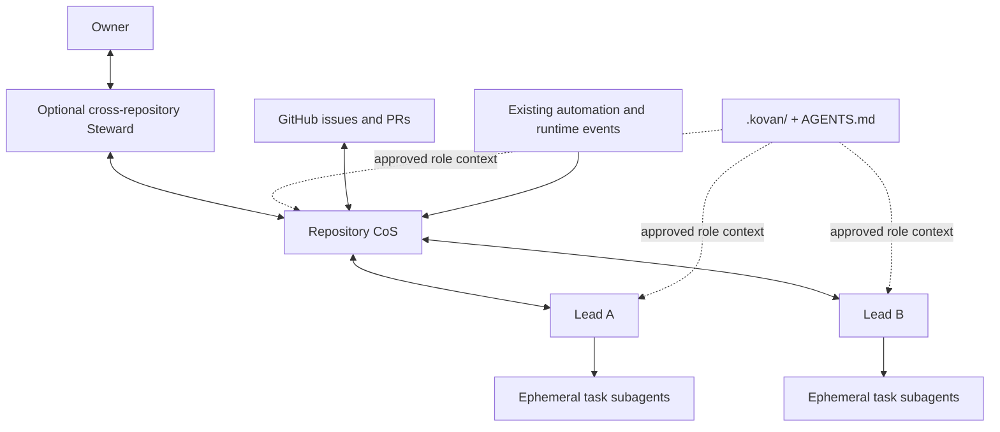

# Architecture and boundaries

**Status: draft convention; not a deployed execution system.**

Kovan defines the structure of a repository's agent organization, not the infrastructure that runs it.

## Separation of concerns

- Kovan: compact, version-controlled role definitions and coordination rules.
- Source control: durable issues, ownership, approvals, checkpoints and delivery evidence.
- Agent runtime: session execution, child delegation, context and lifecycle.
- Existing automation: authenticated wake events, bounded retries and reconciliation.
- Tool and identity systems: capabilities, permissions, scoped credentials and independent access control.
- CI/review and deployment systems: exact-revision verification and authorized release.

There is one authoritative CoS seat per repository and a stable Lead seat per registered domain. Sessions may be persistent and idle without relinquishing their seats. Native subagents are ephemeral. No duplicate seat on wake or restart; replacement requires verified handover and fencing.

## Lifecycle and coordination

An authorized issue event may wake the existing CoS. CoS reads canonical work state, triages, and assigns an eligible Lead within policy and capacity. A Lead delegates a bounded task to a native subagent, which returns evidence. Lead verifies results; CoS reconciles closure. Cross-Lead dependencies are relayed through CoS. Steward can convey human decisions but is not a second repository supervisor.

Use native runtime lifecycle events when verified, plus periodic reconciliation for missing or suppressed events and recovery. Execution completion is not task completion. Deduplicate events, preserve task ownership and verify current revision before acceptance.

## Trust boundary

Role files, session names and issue text are not authentication. Load approved role instructions from a trusted revision; treat task-branch contents and external input as untrusted data. Scope identities and tools independently of role text. A shared runtime is not automatically a security boundary, and a worktree does not isolate credentials. Human approval rules, protected branches, independent review, and deployment gates remain in force.

## Non-goals

No new coding harness, scheduler, database, lease manager, generic chat UI, CI system, GitOps engine or LLM gateway. Prefer existing infrastructure. A portable convention and examples are the first deliverable; any tooling requires a demonstrated need and separate review.

The earlier executable delivery-verification experiments are historical research, not prerequisites for this model. Preserve their provenance and disposition separately. Validate the convention against an actual repository workflow before claiming runtime compatibility or production readiness.
